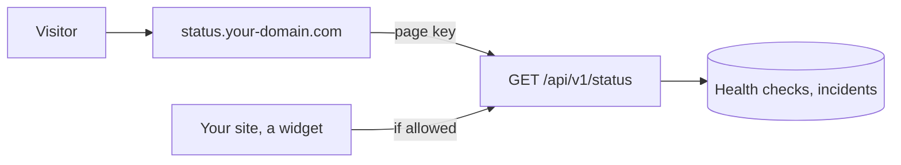

Quasar can publish the state of your applications to people who don't have an account: a JSON API, and optionally a status page on its own subdomain. Nothing is published until you choose it, in **Settings → Status**.

## The API

`GET https://admin.your-domain.com/api/v1/status` returns the status as JSON. See the [API reference](/reference/api/get-status/) for its fields.

Choose who may read it:

| Mode | Who |
| --- | --- |
| **Nobody** | The default. The API answers `404`. |
| **API token holders** | Anyone with an [API token](/reference/api/overview/#tokens), viewer or admin. |
| **Anybody** | No token needed. |

Tick **Readable from other sites** to let a page on another domain fetch it, for example to show the status on your own site.

The status page reads the API with a key of its own, whatever the mode. You can keep the API closed to everybody and still have a page.

## What is published

| Section | Shows |
| --- | --- |
| **Current state** | Each application as operational or down, and an overall state. |
| **Uptime history** | The share of health checks answered today and over 7, 30 and 90 days, and one value per day. |
| **Incidents** | The last 14 days of incidents. |
| **Server health** | CPU, memory and disk in percent. Off by default. |

A section that is turned off is absent from the API, not empty.

## Applications

No application is published by default. Tick the ones to publish, and give each a **public name** if its own name means nothing outside, for example `Photos` for `immich`. An empty public name uses the application's own name.

An application that isn't ticked appears nowhere in the API.

| The application has | Its state comes from | Uptime history |
| --- | --- | --- |
| A [health check](/applications/resources-health/#health-checks) | Its open incident, then its container | Yes |
| No health check | Its container: running or not | No |

## Incidents

An incident opens when an application fails **2 health checks in a row**, so about a minute without an answer, and closes at the next check that answers. It starts at the first failed check.

When the application is [restarted automatically](/applications/resources-health/#health-checks) during an incident, the incident says so.

Incidents are kept as long as the uptime history: 90 days.

## The status page

The page shows the published status: an overall banner, each application with its bars over 90 days, the server and the incidents. It refreshes itself every 30 seconds and runs no script.

1. Point the subdomain at your server, as for an application. A wildcard DNS record already covers it.
2. In **Settings → Status → Status page**, choose the subdomain (`status` by default) and click **Deploy**.
3. The page answers on `https://status.your-domain.com` once its certificate is issued, usually within a minute.

The page runs in its own container, `quasar-status`, started from the dashboard's image:

- It has no access to the database or to Docker, and holds no secret but its key.
- It runs as an unprivileged user, on a read-only filesystem, with no capabilities and 64 MB of memory.
- After an [update](/server/updates/) or a reboot, Quasar recreates it on the new image.

While the page is deployed, no application can take its subdomain.

**Remove the page** stops its subdomain answering and revokes its key. The API is left as it is.
